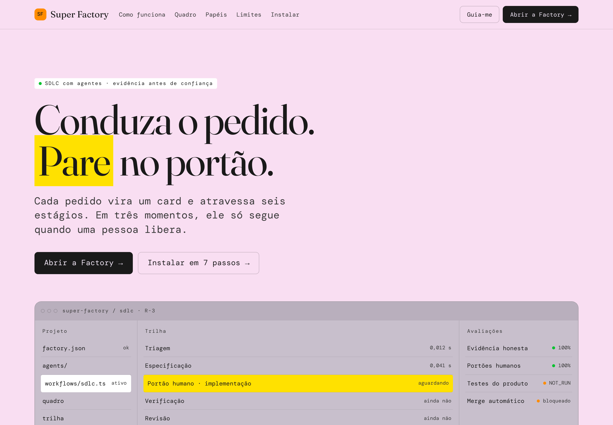

<p align="center">
  
</p>

# Super Factory

**Os agentes conduzem o pedido. Uma pessoa decide quando ele atravessa.**

Um pedido vira card e passa por triagem, especificação, plano, verificação e revisão. Em três momentos (implementação, merge e release) o ciclo para e espera uma pessoa. A Factory não faz merge, não faz push em `main` ou `master` e não coloca nada em produção.

[Comece em 7 passos](#7-passos-para-ver-com-os-próprios-olhos) · [Siga um pedido](#um-pedido-do-começo-ao-fim) · [O que ela recusa](#o-que-a-factory-se-recusa-a-fazer)

---

## O problema

Agentes de código ficaram rápidos. Em minutos eles leem o pedido, escrevem a mudança e abrem o pull request. A pergunta que sobra é outra: **quem decidiu que aquilo podia ir para a branch principal?**

Na maioria dos fluxos, a resposta é ninguém. Um teste que nunca rodou vira "passou". Um token colado no pedido acaba num log. Um "pode mandar" vago vira merge. A velocidade é real, e o julgamento some junto com o atrito.

## A virada: o gate

A Super Factory parte de uma regra simples: **evidência antes de confiança.**

Os agentes fazem o trabalho que dá para observar: triagem, especificação, plano, checks internos, issue e pull request em rascunho. Mas o ciclo para em três gates, e cada um só abre com o nome de uma pessoa, a decisão dela e uma nota:

```json
{ "aprovado": true, "aprovador": "Joana", "nota": "Pode seguir, sem merge." }
```

Nenhum agente preenche isso. Nenhum papel aprova gate. O que muda o repositório passa por gente.

## Um pedido, do começo ao fim

Segunda-feira de manhã. A Joana abre a Factory com um problema concreto:

> **Filtro de datas com hora.** O filtro da API de pedidos quebra quando a data vem só com o dia. Precisa aceitar intervalo com hora e recusar fim anterior ao início.
>
> *Critério:* o endpoint devolve 400 quando o fim do intervalo é anterior ao início.

**1. Triagem.** O Chief of Staff, único papel que abre card, lê o pedido. Tem critério observável, então o card entra em `ready`. Se o pedido fosse vago, trouxesse um segredo ou pedisse force-push, iria direto para `blocked`.

**2. Especificação.** O pedido vira especificação registrada. Nada no repositório muda.

**3. Primeiro gate: implementação.** O ciclo suspende. A Joana lê a especificação e libera.

**4. Plano.** O Architect separa donos e caminhos: Frontend escreve em `src/ui/`, Backend em `src/api/`. Se duas fatias cobrissem o mesmo lugar, o card pararia.

**5. Verificação e revisão.** Os checks internos registram o que foi observado. O teste do produto fica `NOT_RUN`, porque a Factory não executa shell, build nem suíte, e não finge que executou. Security, somente leitura, procura segredo, push protegido e gate furado.

**6. Segundo gate: merge.** O ciclo suspende de novo. A Joana libera o acompanhamento, e não um merge: a Factory não tem endpoint de merge.

**7. Entrega.** A Factory abre a issue no GitHub ou o work item no Azure DevOps e, se existir uma branch de trabalho, um pull request **em rascunho**.

**8. Terceiro gate: release.** A Joana aceita o release. O desfecho é `aceito-com-ressalvas`: o release foi aceito e os testes do produto continuam com quem opera o repositório. Se ela recusasse, o card ficaria `retido` e nada seria publicado.

No fim, o relatório fecha com contexto, critérios, donos, evidência, gates e o próximo passo. Cada passo deixou uma linha na trilha.

### O quadro

| Coluna | Quando o card está aqui |
| --- | --- |
| `backlog` | Ainda não foi triado |
| `ready` | Pedido claro ou bug com critério observável |
| `build` · `qa` · `review` | Em andamento no ciclo |
| `blocked` | Pedido vago, segredo, force-push ou gate recusado |
| `done` | Ciclo fechado |

Cada onda leva no máximo 5 cards prontos, sem dois mexendo no mesmo lugar.

### Os oito papéis

| Papel | O que faz | Onde escreve |
| --- | --- | --- |
| Chief of Staff | Abre o card e encaminha o ciclo | Quadro |
| Architect | Separa donos e caminhos | Plano |
| Frontend | Escreve a interface na implementação | `src/ui/` |
| Backend | Escreve a API na implementação | `src/api/` |
| Integrations | Lê e abre issue ou work item; não faz merge | GitHub, Azure DevOps |
| QA | Lê a evidência; não transforma `NOT_RUN` em `PASS` | Só lê |
| Security | Procura segredo, push protegido e gate furado | Só lê |
| Docs | Diz o que foi observado e o que ficou de fora | Relatório |

## O que a Factory se recusa a fazer

| A Factory faz | Fica com uma pessoa |
| --- | --- |
| Triagem, especificação e plano | Merge: a branch protegida não recebe push |
| Checks internos, com evidência | Deploy: o release não publica nada |
| Issue ou work item no provedor | Force-push e commit direto em `main` |
| Pull request em rascunho | Rodar a suíte do produto e anexar o resultado |

**Segredos não ficam guardados.** Todo corpo JSON que entra na API passa por uma redação antes de chegar ao Mastra: o token vira `[segredo:token-github]`. O valor não entra no snapshot do workflow, na memória nem nos spans, e a triagem continua bloqueando o card pelo marcador. Para limpar um `factory.db` antigo, rode `npm run limpar-segredos`.

## 7 passos para ver com os próprios olhos

Um passo de cada vez. Se o Terminal mostrar uma linha vermelha, copie e cole no chat da Factory: a conversa continua do passo em que você parou e explica o conserto. Não cole chave, token ou senha. A página inicial tem o botão **Guia-me**, que percorre os mesmos passos.

1. **Node.** Instale o Node 22.18 ou mais novo, pelo site nodejs.org. `node -v` precisa mostrar `v22.18` ou um número maior.
2. **Terminal.** No Mac, Command + espaço e escreva Terminal. No Windows, procure PowerShell no Iniciar.
3. **Projeto.** Na primeira vez:
   ```bash
   git clone https://github.com/juliopessan/super-factory.git
   ```
   Se a pasta `super-factory` já existe, não clone de novo: entre nela com `cd ~/super-factory` e atualize com `git fetch origin` e `git checkout -B main origin/main`.
4. **Peças.** Dentro da pasta:
   ```bash
   npm install
   ```
5. **Ligar.** Deixe esta janela aberta. A linha saudável mostra `4721`.
   ```bash
   npm run dev
   ```
6. **Abrir.** `http://localhost:4721` é a apresentação. `http://localhost:4721/studio` é a Factory.
7. **Chave, se quiser.** É opcional. Sem chave, a Factory responde em amostra e avisa. O arquivo `.env` fica só na sua máquina.

### Rode o ciclo da Joana no Studio

Abra o workflow `sdlc` e preencha:

| Campo | Exemplo |
| --- | --- |
| titulo | Filtro de datas com hora |
| descricao | O filtro da API de pedidos quebra quando a data vem só com o dia. Precisa aceitar intervalo com hora e recusar fim anterior ao início. |
| criterios | Uma condição por linha, por exemplo `O endpoint devolve 400 quando o fim do intervalo é anterior ao início.` |
| provedor | `github` ou `azure-devops` |
| repositorio | GitHub: `owner/repo`. Azure: `projeto` ou `projeto/repositorio`. |
| branchBase | `main` |
| branchHead | Uma branch que já existe, se quiser um pull request rascunho. Vazio só abre o item de acompanhamento. |

O workflow suspende três vezes. Em cada uma, retome com o JSON do gate. `aprovado: false` recusa: na implementação ou no merge, o card fecha bloqueado; no release, fica retido.

---

## Por dentro

### Onde está o código

| Caminho | O que guarda |
| --- | --- |
| `src/super-factory/` | Landing, marca SF, agentes, ferramentas e o workflow `sdlc` |
| `src/factory/` | Quadro, gates, trilha, guardas de segredo, GitHub e Azure DevOps |
| `src/scripts/check.ts` | Checagem do ciclo, sem shell e sem suíte de produto |
| `src/scripts/e2e.ts` | Teste de ponta a ponta, pela API e no navegador |
| `factory.json` | Manifesto: estágios, três gates, oito papéis, evidência |

### Comandos

| Comando | O que faz |
| --- | --- |
| `npm run dev` | Sobe a Factory em `localhost:4721` |
| `npm run check` | Typecheck e checagem do ciclo |
| `npm run e2e` | Sobe a Factory sem chave e sem token, conduz o `sdlc` pelos três gates, testa recusas, triagem e redação de segredo, e abre a landing e o Studio no navegador, inclusive em larguras de celular |
| `npm run limpar-segredos` | Troca segredos já gravados no `factory.db` por marcadores e roda `VACUUM` |
| `npm run build` · `npm start` | Gera o servidor e sobe essa versão |

O `npm run e2e` precisa da porta 4721 livre (ou `E2E_REUSE=1` para usar o servidor aberto) e do Playwright: `npm i -D playwright` e `npx playwright install chromium`.

### Credenciais

Copie `.env.example` para `.env` só na sua máquina. O `.env` não entra no repositório.

- **GitHub.** Sem `GITHUB_TOKEN`, listar ou abrir issue devolve a amostra e a nota `Simulado`. Com o token, a chamada vai para `https://api.github.com`. O pull request, quando a branch de origem existe e não é a base, sai como rascunho. Não há endpoint de merge nem de push.
- **Azure DevOps.** Sem `AZURE_DEVOPS_ORG` e `AZURE_DEVOPS_PAT` juntos, fica simulado. Com os dois, work items usam `https://dev.azure.com`. O projeto vem do campo do ciclo; pull request rascunho só quando esse campo vem como `projeto/repositorio`.
- **Modelo.** Sem chave, a Factory local encaminha a frase para a ferramenta certa. Com `OPENAI_API_KEY`, `ANTHROPIC_API_KEY`, `GOOGLE_API_KEY` ou `GOOGLE_GENERATIVE_AI_API_KEY`, os agentes usam o provedor correspondente. `SUPER_FACTORY_MODEL` troca o modelo, no formato `provedor/modelo`; `FACTORY_MODEL` vale quando o primeiro está vazio.
- **Rede.** Por padrão, a Factory só abre neste computador (`localhost`), porque o Studio não tem login: quem alcança a porta 4721 roda agentes e workflows. Para abrir para outras máquinas de propósito, use `SUPER_FACTORY_HOST=0.0.0.0`.

Os identificadores passam por uma lista fechada de caracteres. O token não entra na URL e não é copiado para o relatório.

### Base do projeto

Cada repositório tem a própria base, com as regras que uma pessoa daquele cliente ditou: escrita, pastas, branch, evidência, glossário. `lerBaseProjeto` lê; `registrarRegraProjeto` grava, e o autor é o nome dessa pessoa, nunca um papel da Factory. Base vazia continua vazia: o ciclo segue e ninguém inventa regra de cliente.

`lerPoliticaProjeto` lê a política. Sem página gravada, a autonomia já é entrega humana. `definirPoliticaProjeto` registra a branch protegida e os checks que o cliente nomeou; a Factory não executa esses checks e não aceita merge automático. `relatarMerge` guarda interpretação, premissas e confiança (`confiante` ou `entrega`). Confiança não aprova o gate `beforeMerge`.

### Agentes, MCP e Studio

Fale com o Chief of Staff para ver o quadro, abrir um card ou ler a trilha. Um card aberto pelo agente não atravessa os gates: isso só acontece no workflow `sdlc`. Security responde em leitura e recusa pedido de escrita.

O Studio mostra o servidor MCP `super-factory` e a Factory, com um modo para cada papel. O servidor fica em `/api/mcp/super-factory/mcp` e expõe as ferramentas, os oito agentes e o workflow `sdlc`. A Factory não tem `submit_plan` nem subagente: uma tarefa concluída nela não é um gate. Clientes de fora podem falar com esse endereço; um servidor HTTP adicional entra pelo Studio, na área de MCP, quando alguém cola a URL.

### O harness dos agentes

Em volta do modelo, cada agente tem camadas que valem em toda chamada, escritas no código e não no prompt:

- **Aprovação nas escritas externas.** `criarIssueGithub` e `criarWorkItemAzure` param no chat e só rodam quando uma pessoa aprova. Por isso ficam fora do servidor MCP, que não tem como pedir essa aprovação.
- **Falhas transitórias.** A chamada ao modelo tenta de novo até 2 vezes. O modelo é um só, para o Studio continuar mostrando o seletor de provedor e modelo no chat. Leituras no GitHub e no Azure DevOps repetem em erro de rede, 429 ou 5xx, respeitando o `Retry-After` até 5 s. Escritas tentam uma vez só, para não abrir a mesma issue duas vezes.
- **Contexto.** Na entrada, dados pessoais e segredos saem do texto e o histórico é cortado em 32 mil tokens.
- **Guarda na saída.** Se um agente escrever que fez merge, deploy ou aprovou um gate, a frase é trocada por um aviso. Negações como "nenhum merge foi feito" passam intactas.

### Skills

As skills ficam em `skills/`, em leitura. A skill `super-factory` é o contrato desta Factory: os verbos do quadro viram ferramenta ou workflow `sdlc`. Script, shell, merge, force-push e deploy continuam de fora.

## Créditos e escolhas

- O quadro e a triagem (claro, nebuloso, bug) seguem o modelo operacional do super-board, licença MIT, Copyright 2026 Eric Tech, copiada em `skills/UPSTREAM-LICENSE`.
- O manifesto em `factory.json` reescreve o núcleo (estágios, três gates humanos, oito papéis, evidência e escritas disjuntas) em vez de copiar os textos da Agent Factory.
- A Factory é construída sobre o [Mastra](https://mastra.ai). O nome aparece nos pacotes `@mastra/*` e no comando `mastra dev`; na tela, a marca é Super Factory.
- Gerar código no repositório, executar a suíte, fazer merge, force-push ou deploy ficam de fora de propósito.
